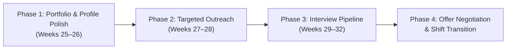

# Post-6-Month Career & Job Hunt Strategy (`POST_6_MONTHS.md`)

> **When to read this:** At Month 6 (Week 24) upon completing Capstone Project 3 and passing the Final Technical Mock Interview.

---

## The 4-Phase Job Transition Roadmap

---

## Phase 1: Portfolio, Resume & Professional Presence (Weeks 25–26)

### 1. Resume Re-Engineering
- **Target Role Title:** *Full-Stack AI Application Engineer* / *Junior AI Engineer* / *Python Backend & AI Engineer*.
- **The "Bridge Narrative" (Your Superpower):**
  - Connect your Electrical & Maintenance Engineering background (reliability, systems troubleshooting, high-uptime monitoring) with backend & AI systems reliability.
  - Highlight your existing React/Next.js frontend skills + Python, FastAPI, pgvector, and LLM orchestration.
- **Bullet Point Formula (Google X-Y-Z Format):**
  - *"Accomplished [X] measured by [Y] by doing [Z]."*
  - *Example:* "Engineered a production-grade RAG support ticket system with FastAPI and pgvector, reducing hallucination rates to <3% across a 50-document evaluation benchmark."

### 2. GitHub Portfolio Polish (The 3 Capstones)
Ensure the 3 repositories look like enterprise-grade open source projects:
- **Project 1:** `01-spam-classifier` (Classical ML, text feature extraction, evaluation metrics).
- **Project 2:** `02-document-intelligence` (Advanced RAG, vector embeddings, chunking, citation grounding).
- **Project 3:** `03-ai-support-ticket-system` (Full production stack: FastAPI + React + PostgreSQL/pgvector + Docker + automated eval).
- **Checklist for each repo:**
  - Live demo link or video walkthrough (Loom / GIF).
  - Clean `README.md` with system architecture diagrams.
  - Pinned `requirements.txt` / `Dockerfile` so anyone can run it in 1 command.
  - Automated test suite with `pytest`.

### 3. LinkedIn Profile Optimization
- Professional headline: *"AI Application Engineer | Python, FastAPI, RAG, PyTorch | Full-Stack (React/Next.js)"*.
- Featured section: Direct links to your 3 GitHub projects and live demos.
- About section: Written in your polished Developer English, telling your journey from CNG systems maintenance to building intelligent software systems.

---

## Phase 2: High-Signal Job Applications & Outreach (Weeks 27–28)

### Target Companies
1. **AI Startups (Seed to Series B):** They value versatile engineers who know both frontend (React) and AI backend (FastAPI, RAG, evaluations).
2. **Software Consultancies & Agencies:** High demand for developers who can integrate LLM APIs and build custom enterprise knowledge bots.
3. **Remote-first International Companies:** US, European, and regional tech teams looking for capable engineers who communicate clearly in English.

### Application Strategy (Quality over Quantity)
- **Do NOT apply to 500 jobs with "Easy Apply":** That has a <1% response rate.
- **The "Loom Walkthrough" Strategy:**
  - Find the Engineering Manager, Tech Lead, or Founder on LinkedIn/Twitter.
  - Record a 90-second Loom video demonstrating one of your projects (e.g. your RAG evaluation pipeline or Ticket System).
  - Send a polite 3-sentence message in English:
    > *"Hi [Name], I noticed [Company] is building [specific feature/product]. I recently built an open-source RAG system with automated hallucination checks using FastAPI and pgvector (GitHub link / 90s demo attached). Would love to learn if your team is looking for an AI Application Engineer who can contribute across the stack."*

---

## Phase 3: Technical Interview Loop (Weeks 29–32)

You will face 3 standard interview stages. We will run mock simulations for each:

| Stage | What They Test | Why You Are Prepared |
| :--- | :--- | :--- |
| **1. Initial Screen (15–30 min)** | Communication, English fluency, background story | You have 6 months of daily standup and professional English logs |
| **2. Technical Coding (45–60 min)** | Python data structures, algorithms, or API building live without AI | You have completed 24 weekly closed-book tests and built tools by hand |
| **3. System Design & Project Deep Dive (60 min)** | RAG architecture, vector search, latency, cost, evaluations | You built and defended all 3 capstones from scratch |

---

## Phase 4: Offer Evaluation & CNG Shift Transition

- Review compensation packages (salary, equity, remote flexibility).
- Provide professional notice to the CNG station with full documentation of maintenance processes (leaving on great terms).
- Officially start your career as a professional **AI Application Engineer**!

